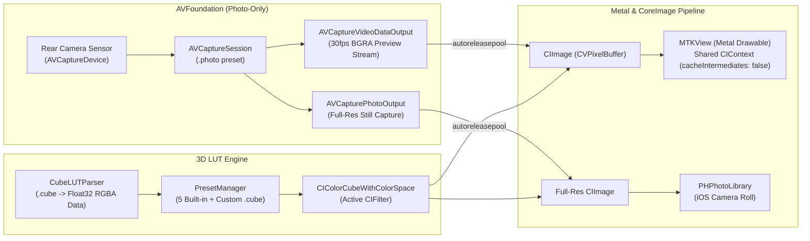

# i-Retro — Project Analysis & Engineering Plan

> **Fokus Produk**: Aplikasi kamera **khusus foto (Photo-Only, Tanpa Video)** bertema *Retro Digicam & Film Simulation* dengan *real-time 3D LUT preview* (WYSIWYG).
> **Repository**: https://github.com/euqith/i-retro.git

---

## 1. Analisis Kebutuhan & Batasan Kritis (Critical Constraints Analysis)

Berdasarkan spesifikasi pada `promptplanning.md`, proyek **i-Retro** memiliki batasan perangkat keras dan perangkat lunak yang sangat ketat:

| Aspek | Spesifikasi | Implikasi Teknis & Solusi Arsitektur |
| :--- | :--- | :--- |
| **Fokus Fitur** | **Hanya Foto (Tanpa Video)** | Tidak menggunakan `AVCaptureMovieFileOutput`, `AVAssetWriter`, maupun input mikrofon (`AVCaptureDeviceInput` audio). `AVCaptureVideoDataOutput` murni dipakai untuk *live viewfinder stream* 30fps menuju Metal view. |
| **Deployment Target** | **iOS 12.0+** (Wajib mendukung **iPhone 5S**) | Tidak boleh menggunakan API iOS 13+ seperti `UISceneDelegate`, `SF Symbols`, `UICollectionViewDiffableDataSource`, atau `UTType` (gunakan string UTI iOS 12 `"public.data"` / `"public.item"`). |
| **UI Framework** | **Swift 5 & UIKit ONLY** (Tanpa SwiftUI) | Seluruh tampilan dibangun secara *programmatic UIKit* (Auto Layout / frame calculation) tanpa Storyboard untuk memangkas *launch time* dan pemakaian memori. |
| **Target Hardware** | **Apple A7 SoC** (Dual-core 1.3 GHz, GPU PowerVR G6430, **1 GB RAM**) | iPhone 5S adalah perangkat 64-bit pertama yang mendukung **Metal**. Namun batas RAM per aplikasi di iOS 12 pada perangkat 1 GB hanya sekitar **~550–600 MB** sebelum terkena terminasi *Jetsam (OOM)*. |
| **Target Performa** | **Stabil 30 fps** tanpa *overheating* / *memory leak* | Waktu proses per frame wajib **< 33.3 ms**. Gunakan satu instance `CIContext(mtlDevice:)` dengan `cacheIntermediates: false`, bungkus setiap siklus frame dalam `autoreleasepool`, dan batasi antrean frame dengan `alwaysDiscardsLateVideoFrames = true`. |

---

## 2. Arsitektur Sistem & Aliran Data (System Architecture)



### Strategi Optimasi Memori & GPU (Khusus Chip A7 / 1 GB RAM)
1. **Zero-Copy Frame Extraction**:
   - Konfigurasi `AVCaptureVideoDataOutput` dengan format `kCVPixelFormatType_32BGRA` agar selaras dengan format tekstur Metal (`MTLPixelFormat.bgra8Unorm`).
   - Buat `CIImage(cvPixelBuffer:)` langsung dari `CMSampleBufferGetImageBuffer(sampleBuffer)` tanpa menyalin byte ke CPU.
2. **Single Reusable Metal `CIContext`**:
   - Membuat `CIContext` adalah operasi yang sangat mahal. Aplikasi hanya boleh menginisialisasi **satu** `CIContext` menggunakan `MTLCreateSystemDefaultDevice()` dan `MTLCommandQueue` bersama.
   - Matikan intermediate caching (`CIContextOption.cacheIntermediates: false`) agar CoreImage tidak menimbun tekstur sementara di VRAM/RAM yang terbatas.
3. **In-Flight Frame Throttling & `autoreleasepool`**:
   - Gunakan `DispatchSemaphore(value: 1)` atau atomic flag di antara `captureOutput(_:didOutput:)` dan selesai komit `MTLCommandBuffer` agar frame baru langsung di-drop jika GPU A7 masih menggambar frame sebelumnya.
   - Setiap frame preview dan setiap proses foto resolusi penuh wajib dibungkus dalam `autoreleasepool { ... }`.
4. **Dimensi 3D LUT yang Efisien**:
   - Mendukung ukuran `.cube` standar (`16x16x16`, `32x32x32`, `33x33x33`, hingga `64x64x64`).
   - Untuk preset bawaan, gunakan ukuran optimal **32x32x32** (hanya `32^3 * 4 * 4 bytes = 524 KB` per LUT) sehingga pergantian filter di `UICollectionView` berlangsung instan (`< 2 ms`) tanpa *frame drop*.
5. **High-Res Photo Processing hemat RAM**:
   - Saat tombol Shutter ditekan, hentikan sementara rendering preview selama pemrosesan JPEG resolusi penuh (8MP–12MP), render hasil `CIImage` yang telah diberi `CIColorCube` melalui `CIContext.jpegRepresentation(of:colorSpace:options:)`, simpan ke `PHPhotoLibrary`, lalu bebaskan memori seketika sebelum melanjutkan preview.

---

## 3. Struktur Direktori Proyek (Modular Swift 5 + UIKit)

```text
i-retro/
├── iRetro.xcodeproj
├── iRetro/
│   ├── App/
│   │   ├── AppDelegate.swift              # Entry point iOS 12 (UIWindow tanpa SceneDelegate)
│   │   └── Info.plist                     # NSCameraUsageDescription, NSPhotoLibraryAddUsageDescription
│   ├── Core/
│   │   ├── LUT/
│   │   │   ├── CubeLUTParser.swift        # Parser .cube -> Float RGBA array -> CIColorCube filter
│   │   │   └── LUTGenerator.swift         # Generator .cube bawaan (5 film simulation presets)
│   │   └── Presets/
│   │       ├── FilmPreset.swift           # Model data preset (id, name, cubeDimension, cubeData, isCustom)
│   │       └── PresetManager.swift        # Loader preset bawaan & custom dari Documents/CustomLUTs
│   ├── Camera/
│   │   ├── MetalPreviewView.swift         # Subclass MTKView untuk render CIImage 30fps bebas leak
│   │   └── CameraViewController.swift     # AVCaptureSession, VideoDataOutput, PhotoOutput, UI & Import
│   ├── UI/
│   │   └── PresetCollectionViewCell.swift # Cell bergaya retro digicam untuk carousel filter bawah
│   └── Resources/
│       └── Presets/                       # File .cube bawaan (Japanese Airy, Classic Chrome, dll.)
└── PLANNING.md
```

---

## 4. Breakdown Epik & Issue (GitHub Roadmap)

Seluruh pekerjaan dibagi menjadi **5 Epik utama** dan **14 Issue teknis** yang terstruktur untuk di-push ke GitHub repository `euqith/i-retro`:

### [EPIC 1: Foundation & iOS 12.0 Photo-Only Architecture](https://github.com/euqith/i-retro/issues/3)
*Tujuan*: Menyiapkan fondasi proyek iOS 12.0+ murni menggunakan Swift 5 dan programmatic UIKit tanpa SwiftUI/Storyboard serta konfigurasi izin kamera dan galeri foto.
- **[Issue #1](https://github.com/euqith/i-retro/issues/1)**: `[Foundation] Setup iOS 12.0+ App Lifecycle & Programmatic UIKit Bootstrap (No SwiftUI)`
- **[Issue #2](https://github.com/euqith/i-retro/issues/2)**: `[Foundation] Konfigurasi Photo-Only Permissions (Camera & Photo Library) tanpa Audio/Video`

### [EPIC 2: Camera Engine & 30fps Metal Live Rendering (`CameraViewController.swift`)](https://github.com/euqith/i-retro/issues/7)
*Tujuan*: Mengambil stream kamera belakang secara real-time untuk viewfinder foto dan merendernya menggunakan Metal (`MTKView`) pada 30fps stabil di chip A7 tanpa kebocoran memori.
- **[Issue #4](https://github.com/euqith/i-retro/issues/4)**: `[Camera Engine] Inisialisasi Photo-Only AVCaptureSession (Rear Camera & 30fps Lock)`
- **[Issue #5](https://github.com/euqith/i-retro/issues/5)**: `[Camera Engine] Konfigurasi AVCaptureVideoDataOutput Real-Time Frame Stream (CMSampleBuffer)`
- **[Issue #6](https://github.com/euqith/i-retro/issues/6)**: `[Camera Engine] GPU-Accelerated MTKView Live Preview & Aggressive Memory Management`

### [EPIC 3: 3D LUT Processing Pipeline (`CubeLUTParser.swift`)](https://github.com/euqith/i-retro/issues/11)
*Tujuan*: Membangun parser file `.cube` 3D LUT yang cepat, tahan terhadap variasi format/komentar, dan hemat memori untuk dikonversi menjadi filter `CIColorCube` / `CIColorCubeWithColorSpace`.
- **[Issue #8](https://github.com/euqith/i-retro/issues/8)**: `[3D LUT Pipeline] Implementasi Parser File .cube 3D LUT (CubeLUTParser.swift)`
- **[Issue #9](https://github.com/euqith/i-retro/issues/9)**: `[3D LUT Pipeline] Konversi Matriks RGB ke Data Float32 RGBA & Pembuatan Filter CIColorCube`
- **[Issue #10](https://github.com/euqith/i-retro/issues/10)**: `[3D LUT Pipeline] Injeksi Real-Time CIColorCube ke AVCaptureVideoDataOutput (WYSIWYG)`

### [EPIC 4: Retro Digicam UI & Film Preset Management (`PresetManager.swift` & UI Setup)](https://github.com/euqith/i-retro/issues/15)
*Tujuan*: Menyediakan antarmuka kamera retro minimalis (viewfinder 4:3, tombol shutter bundar, carousel filter horizontal) beserta 5 preset simulasi film bawaan.
- **[Issue #12](https://github.com/euqith/i-retro/issues/12)**: `[Preset Manager] Implementasi PresetManager.swift & 5 Built-in Film Simulation Presets`
- **[Issue #13](https://github.com/euqith/i-retro/issues/13)**: `[Retro UI] Desain Antarmuka Minimalist Retro Digicam (4:3 Viewfinder, HUD & Circular Shutter)`
- **[Issue #14](https://github.com/euqith/i-retro/issues/14)**: `[Retro UI] Horizontal UICollectionView Filter Carousel & Instant Filter Swapping`

### [EPIC 5: Custom `.cube` Import, High-Res Photo Capture & Hardware Profiling](https://github.com/euqith/i-retro/issues/19)
*Tujuan*: Memungkinkan pengguna mengimpor file `.cube` kustom dari Files/iCloud serta memotret foto resolusi tinggi dengan filter aktif dan menyimpannya ke Camera Roll.
- **[Issue #16](https://github.com/euqith/i-retro/issues/16)**: `[Custom Import] Fitur Import File .cube via UIDocumentPickerViewController & Persistensi Lokal`
- **[Issue #17](https://github.com/euqith/i-retro/issues/17)**: `[High-Res Capture] Implementasi AVCapturePhotoOutput, Render Active CIColorCube & Save ke PHPhotoLibrary`
- **[Issue #18](https://github.com/euqith/i-retro/issues/18)**: `[Optimization & QA] Hardware Profiling, Memory Leak Audit & Verifikasi 30fps pada iPhone 5S (A7)`

---

## 5. Rencana Implementasi Kode Modular (Deliverables)

Selain dokumen perencanaan dan struktur Epic/Issue di GitHub, kode lengkap modular Swift 5 (iOS 12.0+, UIKit-only) akan disiapkan dan dipisahkan secara jelas per file:
1. `CubeLUTParser.swift` — Parser `.cube` 3D LUT & generator `CIColorCubeWithColorSpace`.
2. `PresetManager.swift` — Model `FilmPreset`, pengelola 5 preset bawaan + penyimpanan custom `.cube` di `Documents/CustomLUTs`.
3. `CameraViewController.swift` — Engine `AVCaptureSession`, `AVCaptureVideoDataOutput`, `AVCapturePhotoOutput`, renderer `MTKView` 30fps hemat RAM, UI Retro Digicam (`UICollectionView` + Shutter Button), `UIDocumentPickerViewController`, dan penyimpanan `PHPhotoLibrary`.
4. `AppDelegate.swift` — Bootstrap aplikasi iOS 12.0+ tanpa Storyboard/SceneDelegate.
